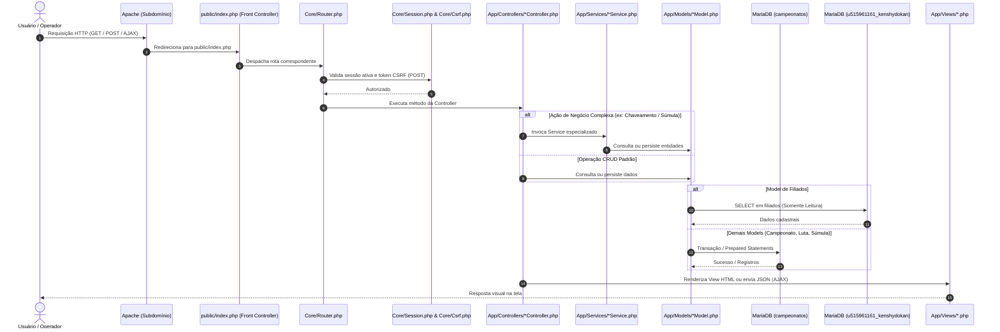

# DOCUMENTO DE ARQUITETURA DE SOFTWARE
## Sistema de Gestão de Campeonatos e Súmulas Kenshydokan Jutsu
**Subdomínio**: `campeonatos.kenshydokan.org.br`  
**Padrão**: MVC (Model-View-Controller) Desacoplado em PHP 8.4 Puro

---

## 1. Visão Geral e Princípios Arquiteturais

A arquitetura do sistema foi projetada sob os seguintes pilares fundamentais:

1. **PHP Puro Sem Frameworks**: Nenhum microframework ou framework corporativo é utilizado. Toda a infraestrutura (roteamento, injeção de dependências básica, despacho de controladores, renderização de templates e abstração de banco) é implementada em código nativo, limpo e auditável.
2. **Isolamento Total do Subdomínio**: A aplicação reside no diretório `campeonatos/` e seu DocumentRoot público aponta exclusivamente para `campeonatos/public/`, garantindo que arquivos de configuração, models, controllers, storage e documentação fiquem inacessíveis diretamente via web.
3. **Isolamento de Banco de Dados (Dual-Database Pattern)**:
   - **Banco Operacional (`campeonatos`)**: Armazena 100% dos dados gerados pela plataforma de campeonatos.
   - **Banco Corporativo do Site Raiz (`u515961161_kenshydokan`)**: Acessado exclusivamente em modo de **somente leitura** por meio do `FiliadoModel` para carregar a lista de atletas cadastrados. Nenhuma escrita ou alteração de esquema é permitida no banco raiz.
4. **Resiliência Histórica por Snapshots**: A aplicação não depende de dados voláteis do cadastro de filiados para reproduzir o passado. No ato da inscrição, é gravado um snapshot dos dados do atleta, garantindo que mudanças futuras no perfil corporativo não distorçam súmulas ou certificados de eventos já homologados.

---

## 2. Diagrama de Fluxo de Requisição (Request Lifecycle)



---

## 3. Detalhamento das Camadas do Sistema

### 3.1 Camada `Core` (Núcleo)
- `Database.php`: Singleton que provê instâncias da extensão nativa `mysqli`. Gerencia transações (`begin_transaction`, `commit`, `rollback`) com tratamento rigoroso de erros e suporte à conexão secundária do banco raiz.
- `Router.php`: Roteador leve baseado em verbos HTTP (GET, POST) e caminhos amigáveis (`/campeonato/novo`, `/sumula/kumite/{id}`).
- `Controller.php`: Classe base abstrata fornecendo helpers para renderização de views com layout compartilhado, envio de respostas JSON, redirecionamentos e sanitização.
- `View.php`: Mecanismo seguro de renderização que extrai variáveis para templates PHP com proteção automática contra XSS.
- `Session.php`: Gestão de sessões com segurança (`session_regenerate_id`, timeouts de inatividade e cookies HttpOnly/Secure).
- `Csrf.php`: Geração e verificação criptográfica de tokens CSRF obrigatórios em formulários e requisições assíncronas.

### 3.2 Camada `Models` (Acesso a Dados)
Todos os models utilizam estritamente Prepared Statements com `bind_param`.
- `FiliadoModel.php`: Conecta ao banco do site principal para leitura de atletas, filtrando por confirmação e relacionando com graduações.
- `CampeonatoModel.php`: Persiste configurações e ciclo de vida das competições.
- `CategoriaModel.php`: Gerencia critérios etários, de graduação, modalidade e peso.
- `InscricaoModel.php`: Registra a participação do atleta com o snapshot cadastral correspondente.
- `PesagemModel.php`: Registra as pesagens oficiais e liberações para o chaveamento.
- `ChaveModel.php`: Armazena a estrutura da chave, participantes e fases.
- `LutaModel.php`: Controla o confronto individual, atletas (Aka vs Shiro), tatame e status.
- `SumulaKumiteModel.php`, `SumulaKataModel.php`, `SumulaTameshiwariModel.php`: Persistem as súmulas específicas de cada modalidade.
- `AuditoriaModel.php`: Registra logs inalteráveis de cada ação administrativa e arbitral.

### 3.3 Camada `Services` (Regras de Negócio)
- `KumiteEngineService.php`: Encapsula a lógica de combate:
  - Validação do acúmulo de 6 Waza-ari (3.0 pontos) para encerramento antecipado;
  - Conversão matemática de 2 Chuis em 0.5 ponto (Waza-ari) para o adversário;
  - Controle de Golden Score na prorrogação;
  - Controle do cronômetro de Ne Waza (60 segundos) e contagem protetora (10 segundos).
- `KataEngineService.php`:
  - Cálculo de média aritmética exata para bancas de 3 a 5 árbitros;
  - Gestão de rodadas de desempate com novo kata.
- `TameshiwariEngineService.php`:
  - Apuração das 4 estações de quebramento;
  - Validação de 1 tentativa por oficina e persistência para desempate de Kumite.
- `ChaveamentoService.php`:
  - Algoritmo de sorteio de eliminatória simples e repescagem;
  - Balanceamento de *byes* (potências de 2);
  - Separação de atletas da mesma academia na rodada inicial.
- `PdfService.php`:
  - Integração robusta com a biblioteca FPDF para geração de súmulas oficiais, chaves gráficas, listas de pesagem e certificados com código de validação único.

### 3.4 Camada `Views` e Frontend
- A interface é construída com **Bootstrap 5**, mantendo estética moderna, intuitiva e funcional.
- **Painel de Súmula**: Layout específico de tela cheia, com alto contraste e botões de grande dimensão, otimizado para operação rápida em notebooks e tablets ao lado do tatame.
- Componentes enriquecidos com **Select2** (pesquisa rápida de atletas), **DataTables** (tabelas ordenáveis e paginadas), **Chart.js** (gráficos no dashboard) e **AlertifyJS** (notificações visuais elegantes).

---

## 4. Estrutura Física de Diretórios

```
d:/WAMP64/www/site_kenshydokan_php_puro/campeonatos/
├── .env.example
├── .env
├── config/
│   ├── app.php                       # Configurações gerais (nome, timezone, URLs)
│   └── database.php                  # Credenciais dos dois bancos
├── database/
│   ├── migrations/                   # Scripts SQL versionados para o banco campeonatos
│   └── seeds/                        # Carga inicial (usuário admin padrão, categorias modelo)
├── docs/                             # Documentação técnica oficial
├── storage/
│   ├── logs/                         # Logs de erros e auditoria técnica
│   ├── uploads/                      # Logos e documentos enviados
│   └── generated/                    # PDFs temporários gerados pelo FPDF
├── app/
│   ├── Core/
│   │   ├── Database.php
│   │   ├── Router.php
│   │   ├── Controller.php
│   │   ├── View.php
│   │   ├── Session.php
│   │   └── Csrf.php
│   ├── Controllers/
│   │   ├── AuthController.php
│   │   ├── DashboardController.php
│   │   ├── CampeonatoController.php
│   │   ├── CategoriaController.php
│   │   ├── InscricaoController.php
│   │   ├── PesagemController.php
│   │   ├── ChaveamentoController.php
│   │   ├── TatameController.php
│   │   ├── SumulaKumiteController.php
│   │   ├── SumulaKataController.php
│   │   ├── SumulaTameshiwariController.php
│   │   ├── HomologacaoController.php
│   │   ├── CertificadoController.php
│   │   ├── RelatorioController.php
│   │   └── AuditoriaController.php
│   ├── Models/
│   │   ├── FiliadoModel.php
│   │   ├── CampeonatoModel.php
│   │   ├── CategoriaModel.php
│   │   ├── InscricaoModel.php
│   │   ├── PesagemModel.php
│   │   ├── ChaveModel.php
│   │   ├── LutaModel.php
│   │   ├── SumulaKumiteModel.php
│   │   ├── SumulaKataModel.php
│   │   ├── SumulaTameshiwariModel.php
│   │   ├── ClassificacaoModel.php
│   │   ├── CertificadoModel.php
│   │   ├── UsuarioModel.php
│   │   └── AuditoriaModel.php
│   ├── Services/
│   │   ├── ChaveamentoService.php
│   │   ├── KumiteEngineService.php
│   │   ├── KataEngineService.php
│   │   ├── TameshiwariEngineService.php
│   │   ├── PesagemService.php
│   │   ├── PdfService.php
│   │   └── AuditoriaService.php
│   ├── Validators/
│   │   ├── InscricaoValidator.php
│   │   ├── CategoriaValidator.php
│   │   └── PesagemValidator.php
│   ├── Policies/
│   │   └── AuthorizationPolicy.php
│   └── Views/
│       ├── layouts/
│       │   ├── main.php
│       │   ├── tatame.php
│       │   ├── navbar.php
│       │   └── footer.php
│       ├── auth/
│       ├── dashboard/
│       ├── campeonatos/
│       ├── categorias/
│       ├── inscricoes/
│       ├── pesagem/
│       ├── chaveamento/
│       ├── tatames/
│       ├── sumulas/
│       ├── resultados/
│       ├── certificados/
│       ├── relatorios/
│       └── auditoria/
├── public/
│   ├── index.php                     # Front-controller único
│   ├── .htaccess                     # Reescrita para subdomínio
│   └── assets/
│       ├── css/
│       ├── js/
│       └── vendor/                   # Links ou inclusões locais das bibliotecas de ../libs/
└── tests/
    ├── Unit/
    └── Integration/
```
