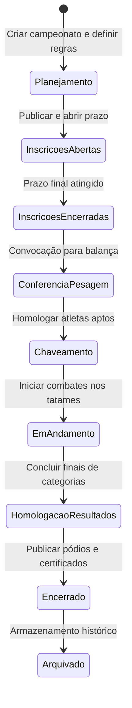
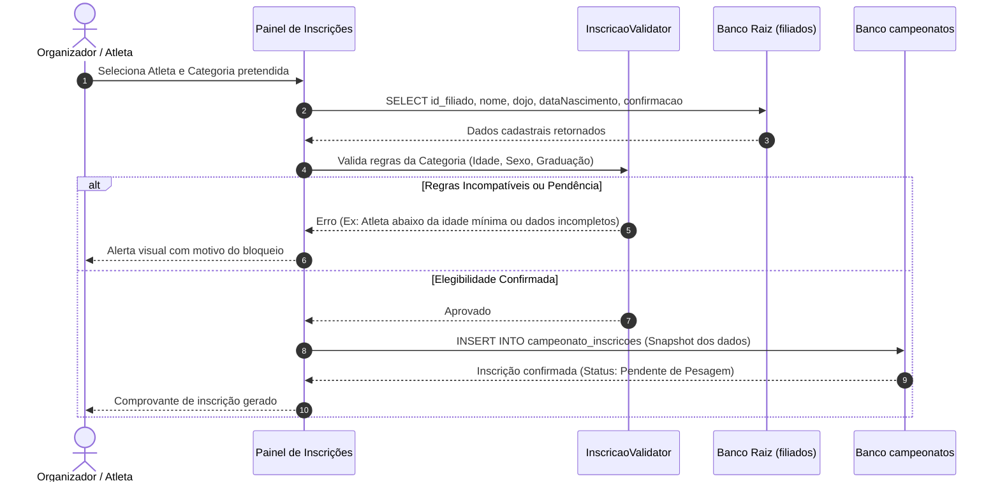
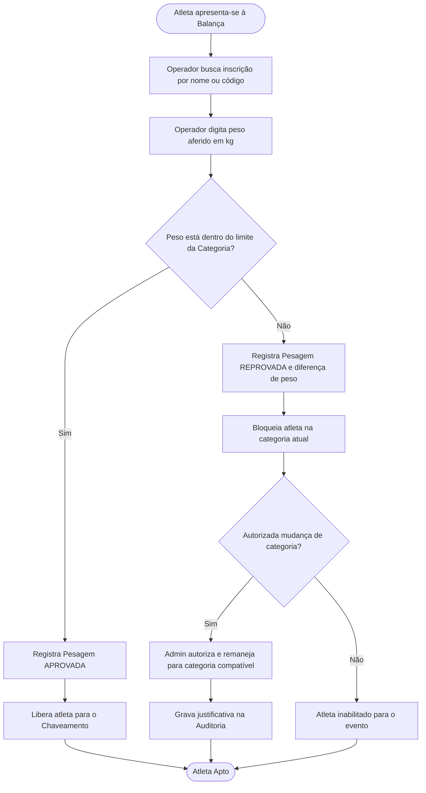
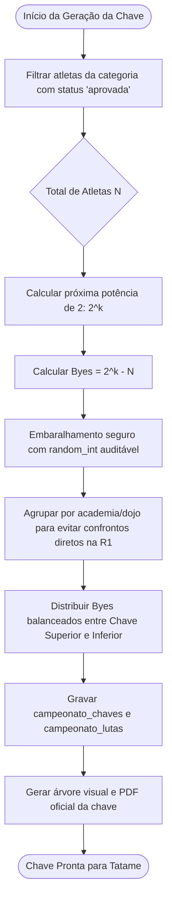
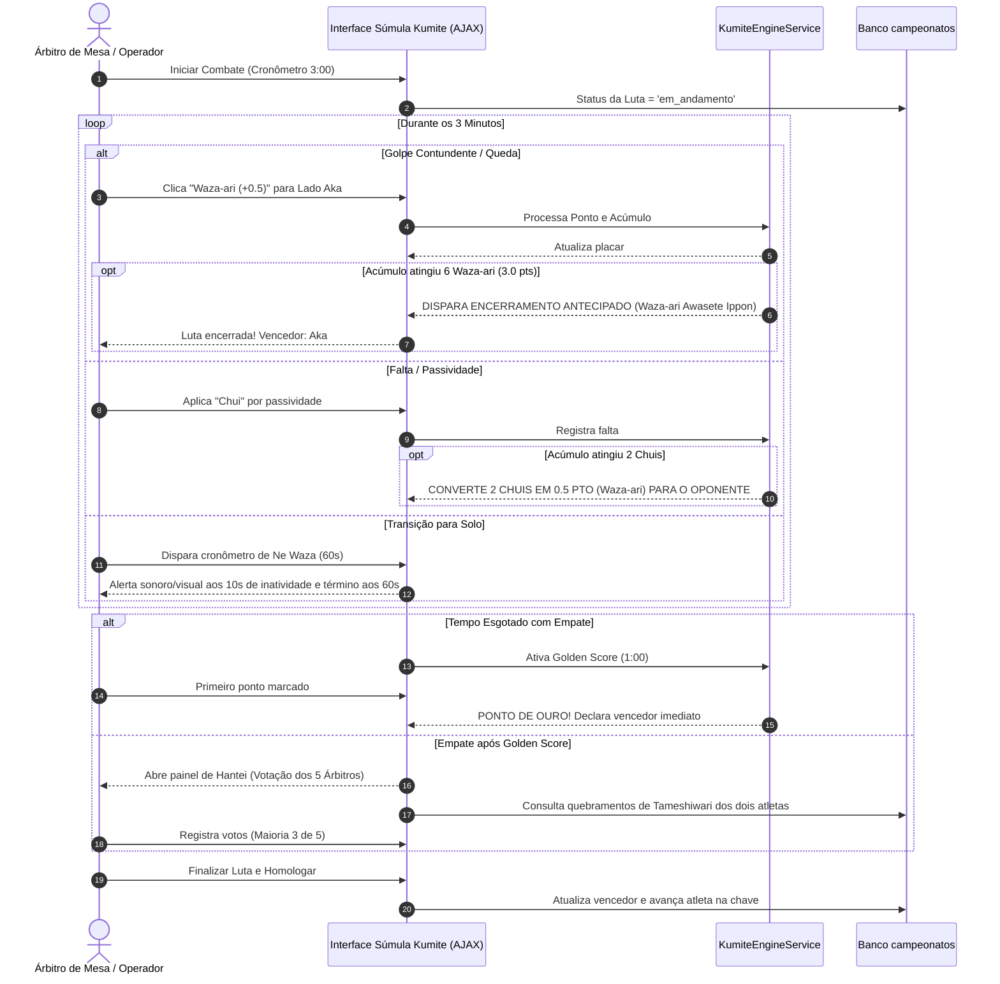
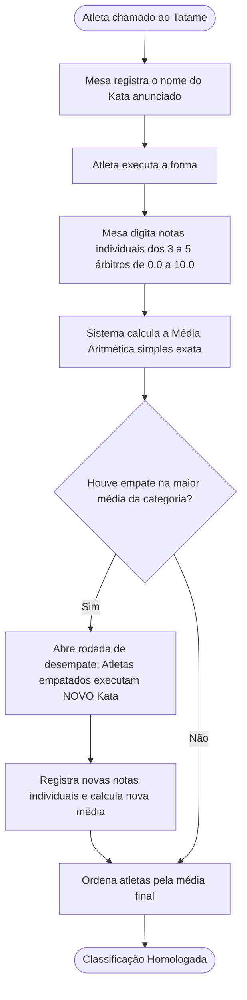
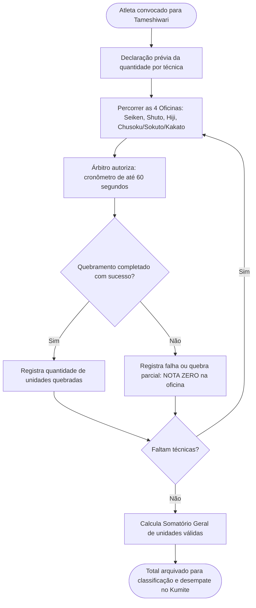

# FLUXOS OPERACIONAIS E DIAGRAMAS DE SEQUÊNCIA
## Sistema de Campeonatos e Súmulas Kenshydokan Jutsu
**Módulos**: Ciclo de Vida, Inscrição, Pesagem, Chaveamento, Kumite, Kata, Tameshiwari e Homologação

---

## 1. Fluxo do Ciclo de Vida do Campeonato

---

## 2. Fluxo de Inscrição e Criação de Snapshot

---

## 3. Fluxo de Pesagem Oficial e Balança

---

## 4. Fluxo de Sorteio e Geração de Chaves (Eliminatórias)

---

## 5. Fluxo de Arbitragem de Kumite em Tempo Real (Súmula Digital)

---

## 6. Fluxo de Avaliação de Kata (Formas)

---

## 7. Fluxo de Avaliação de Tameshiwari (Quebramento)

