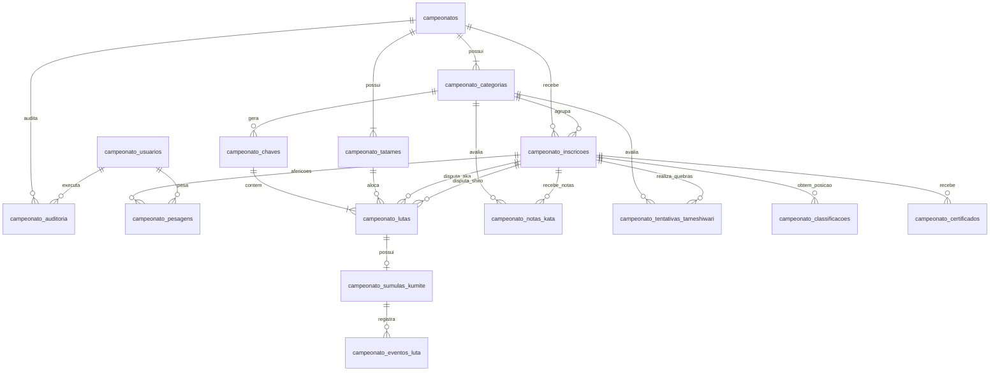

# MODELO DE DADOS E ESQUEMA DO BANCO
## Sistema de Campeonatos e Súmulas Kenshydokan Jutsu
**Banco Principal do Sistema**: `campeonatos`  
**Banco Corporativo Externo (Somente Leitura)**: `u515961161_kenshydokan`  
**Charset Padrão**: `utf8mb4` | **Collation**: `utf8mb4_unicode_ci` | **Engine**: `InnoDB`

---

## 1. Visão Geral do Modelo de Dados

O banco de dados do sistema de campeonatos foi projetado para assegurar integridade referencial estrita, performance em operações de alta concorrência durante eventos ao vivo e rastreabilidade total de cada pontuação e decisão arbitral.

### 1.1 Separação de Esquemas
- As tabelas operacionais da competição residem exclusivamente no banco **`campeonatos`**.
- Os dados cadastrais dos atletas são lidos da tabela `filiados` do banco raiz **`u515961161_kenshydokan`**.
- **Chaves Estrangeiras Lógicas**: Como `filiados` está em outro banco de dados, o campo `id_filiado` na tabela `campeonato_inscricoes` é gerenciado como chave estrangeira lógica validada pela aplicação em `InscricaoValidator.php`. As demais tabelas internas de `campeonatos` utilizam `FOREIGN KEY` físicas com `ON DELETE RESTRICT` ou `CASCADE` apropriadas.

---

## 2. Diagrama Entidade-Relacionamento (DER)



---

## 3. DDL e Especificação Técnica das Tabelas

### 3.1 Tabela `campeonatos`
Armazena os eventos e seu ciclo de vida.
```sql
CREATE TABLE `campeonatos` (
  `id_campeonato` INT(11) NOT NULL AUTO_INCREMENT,
  `titulo` VARCHAR(255) NOT NULL,
  `edicao` VARCHAR(50) DEFAULT NULL,
  `ano` INT(4) NOT NULL,
  `local` VARCHAR(255) NOT NULL,
  `cidade` VARCHAR(100) NOT NULL,
  `estado` VARCHAR(50) NOT NULL,
  `data_inicio` DATE NOT NULL,
  `data_fim` DATE NOT NULL,
  `data_referencia_idade` DATE NOT NULL,
  `organizador` VARCHAR(255) NOT NULL,
  `status` ENUM('planejamento', 'inscricoes_abertas', 'inscricoes_encerradas', 'conferencia_pesagem', 'chaveamento', 'em_andamento', 'encerrado', 'arquivado') NOT NULL DEFAULT 'planejamento',
  `modalidades_habilitadas` VARCHAR(255) NOT NULL DEFAULT 'kumite,kata,tameshiwari',
  `regras_config` JSON DEFAULT NULL,
  `data_criacao` DATETIME NOT NULL DEFAULT CURRENT_TIMESTAMP,
  `data_atualizacao` DATETIME NOT NULL DEFAULT CURRENT_TIMESTAMP ON UPDATE CURRENT_TIMESTAMP,
  PRIMARY KEY (`id_campeonato`),
  INDEX `idx_status` (`status`),
  INDEX `idx_datas` (`data_inicio`, `data_fim`)
) ENGINE=InnoDB DEFAULT CHARSET=utf8mb4 COLLATE=utf8mb4_unicode_ci;
```

### 3.2 Tabela `campeonato_categorias`
Define as divisões competitivas por campeonato.
```sql
CREATE TABLE `campeonato_categorias` (
  `id_categoria` INT(11) NOT NULL AUTO_INCREMENT,
  `id_campeonato` INT(11) NOT NULL,
  `modalidade` ENUM('kumite', 'kata', 'tameshiwari') NOT NULL,
  `nome` VARCHAR(255) NOT NULL,
  `sexo` ENUM('M', 'F', 'misto') NOT NULL,
  `idade_min` INT(3) NOT NULL DEFAULT 0,
  `idade_max` INT(3) NOT NULL DEFAULT 99,
  `peso_min` DECIMAL(5,2) DEFAULT NULL,
  `peso_max` DECIMAL(5,2) DEFAULT NULL,
  `graduacao_inicio_id` INT(11) DEFAULT NULL,
  `graduacao_fim_id` INT(11) DEFAULT NULL,
  `nivel_competitivo` VARCHAR(100) DEFAULT 'Geral',
  `exige_pesagem` TINYINT(1) NOT NULL DEFAULT 1,
  `status` ENUM('ativa', 'inativa', 'cancelada') NOT NULL DEFAULT 'ativa',
  `data_criacao` DATETIME NOT NULL DEFAULT CURRENT_TIMESTAMP,
  PRIMARY KEY (`id_categoria`),
  INDEX `idx_camp_mod` (`id_campeonato`, `modalidade`),
  CONSTRAINT `fk_cat_campeonato` FOREIGN KEY (`id_campeonato`) REFERENCES `campeonatos` (`id_campeonato`) ON DELETE CASCADE
) ENGINE=InnoDB DEFAULT CHARSET=utf8mb4 COLLATE=utf8mb4_unicode_ci;
```

### 3.3 Tabela `campeonato_tatames`
Representa as áreas de combate e suas filas operacionais.
```sql
CREATE TABLE `campeonato_tatames` (
  `id_tatame` INT(11) NOT NULL AUTO_INCREMENT,
  `id_campeonato` INT(11) NOT NULL,
  `numero` INT(3) NOT NULL,
  `nome` VARCHAR(100) NOT NULL,
  `status` ENUM('disponivel', 'em_luta', 'pausado', 'concluido') NOT NULL DEFAULT 'disponivel',
  `id_operador_atual` INT(11) DEFAULT NULL,
  `luta_em_andamento_id` INT(11) DEFAULT NULL,
  PRIMARY KEY (`id_tatame`),
  UNIQUE KEY `uk_camp_tatame` (`id_campeonato`, `numero`),
  CONSTRAINT `fk_tatame_camp` FOREIGN KEY (`id_campeonato`) REFERENCES `campeonatos` (`id_campeonato`) ON DELETE CASCADE
) ENGINE=InnoDB DEFAULT CHARSET=utf8mb4 COLLATE=utf8mb4_unicode_ci;
```

### 3.4 Tabela `campeonato_inscricoes`
Armazena a inscrição do atleta e o snapshot cadastral imutável.
```sql
CREATE TABLE `campeonato_inscricoes` (
  `id_inscricao` INT(11) NOT NULL AUTO_INCREMENT,
  `id_campeonato` INT(11) NOT NULL,
  `id_categoria` INT(11) NOT NULL,
  `id_filiado` INT(11) NOT NULL,
  `nome_atleta_snapshot` VARCHAR(255) NOT NULL,
  `dojo_snapshot` VARCHAR(255) NOT NULL,
  `graduacao_id_snapshot` INT(11) NOT NULL,
  `graduacao_nome_snapshot` VARCHAR(100) NOT NULL,
  `data_nascimento_snapshot` DATE NOT NULL,
  `idade_evento` INT(3) NOT NULL,
  `sexo` ENUM('M', 'F') NOT NULL,
  `peso_declarado` DECIMAL(5,2) DEFAULT NULL,
  `status_elegibilidade` ENUM('pendente', 'aprovada', 'reprovada', 'desistente', 'desclassificada') NOT NULL DEFAULT 'pendente',
  `motivo_reprovacao` TEXT DEFAULT NULL,
  `data_inscricao` DATETIME NOT NULL DEFAULT CURRENT_TIMESTAMP,
  PRIMARY KEY (`id_inscricao`),
  UNIQUE KEY `uk_atleta_categoria` (`id_categoria`, `id_filiado`),
  INDEX `idx_camp_filiado` (`id_campeonato`, `id_filiado`),
  CONSTRAINT `fk_insc_campeonato` FOREIGN KEY (`id_campeonato`) REFERENCES `campeonatos` (`id_campeonato`) ON DELETE CASCADE,
  CONSTRAINT `fk_insc_categoria` FOREIGN KEY (`id_categoria`) REFERENCES `campeonato_categorias` (`id_categoria`) ON DELETE CASCADE
) ENGINE=InnoDB DEFAULT CHARSET=utf8mb4 COLLATE=utf8mb4_unicode_ci;
```

### 3.5 Tabela `campeonato_pesagens`
Registra a conferência de balança do atleta.
```sql
CREATE TABLE `campeonato_pesagens` (
  `id_pesagem` INT(11) NOT NULL AUTO_INCREMENT,
  `id_inscricao` INT(11) NOT NULL,
  `id_campeonato` INT(11) NOT NULL,
  `peso_aferido` DECIMAL(5,2) NOT NULL,
  `unidade` VARCHAR(5) NOT NULL DEFAULT 'kg',
  `data_hora` DATETIME NOT NULL DEFAULT CURRENT_TIMESTAMP,
  `id_operador` INT(11) NOT NULL,
  `resultado` ENUM('aprovado', 'reprovado') NOT NULL,
  `diferenca_peso` DECIMAL(5,2) NOT NULL DEFAULT 0.00,
  `observacoes` TEXT DEFAULT NULL,
  PRIMARY KEY (`id_pesagem`),
  INDEX `idx_pesagem_insc` (`id_inscricao`),
  CONSTRAINT `fk_pesagem_insc` FOREIGN KEY (`id_inscricao`) REFERENCES `campeonato_inscricoes` (`id_inscricao`) ON DELETE CASCADE
) ENGINE=InnoDB DEFAULT CHARSET=utf8mb4 COLLATE=utf8mb4_unicode_ci;
```

### 3.6 Tabela `campeonato_chaves`
Estrutura da árvore eliminatória de cada categoria.
```sql
CREATE TABLE `campeonato_chaves` (
  `id_chave` INT(11) NOT NULL AUTO_INCREMENT,
  `id_campeonato` INT(11) NOT NULL,
  `id_categoria` INT(11) NOT NULL,
  `tipo_formato` ENUM('eliminatoria_simples', 'repescagem') NOT NULL DEFAULT 'eliminatoria_simples',
  `total_atletas` INT(4) NOT NULL,
  `total_rodadas` INT(2) NOT NULL,
  `status` ENUM('rascunho', 'sorteada', 'em_andamento', 'finalizada') NOT NULL DEFAULT 'rascunho',
  `versao` INT(3) NOT NULL DEFAULT 1,
  `arvore_json` JSON DEFAULT NULL,
  `data_geracao` DATETIME NOT NULL DEFAULT CURRENT_TIMESTAMP,
  PRIMARY KEY (`id_chave`),
  UNIQUE KEY `uk_chave_cat_versao` (`id_categoria`, `versao`),
  CONSTRAINT `fk_chave_categoria` FOREIGN KEY (`id_categoria`) REFERENCES `campeonato_categorias` (`id_categoria`) ON DELETE CASCADE
) ENGINE=InnoDB DEFAULT CHARSET=utf8mb4 COLLATE=utf8mb4_unicode_ci;
```

### 3.7 Tabela `campeonato_lutas`
Confrontos individuais do torneio.
```sql
CREATE TABLE `campeonato_lutas` (
  `id_luta` INT(11) NOT NULL AUTO_INCREMENT,
  `id_chave` INT(11) NOT NULL,
  `id_campeonato` INT(11) NOT NULL,
  `id_categoria` INT(11) NOT NULL,
  `id_tatame` INT(11) DEFAULT NULL,
  `numero_luta` INT(5) NOT NULL,
  `rodada` INT(2) NOT NULL,
  `posicao_na_chave` INT(4) NOT NULL,
  `id_inscricao_aka` INT(11) DEFAULT NULL,
  `id_inscricao_shiro` INT(11) DEFAULT NULL,
  `id_vencedor` INT(11) DEFAULT NULL,
  `proxima_luta_id` INT(11) DEFAULT NULL,
  `luta_repescagem_id` INT(11) DEFAULT NULL,
  `status` ENUM('agendada', 'chamada', 'em_andamento', 'concluida', 'homologada', 'cancelada') NOT NULL DEFAULT 'agendada',
  `forma_vitoria` ENUM('ko', 'tko', 'finalizacao', 'pontos', 'hantei', 'hansoku_make', 'wo', 'desistencia') DEFAULT NULL,
  `ordem_fila` INT(5) DEFAULT NULL,
  `data_inicio` DATETIME DEFAULT NULL,
  `data_fim` DATETIME DEFAULT NULL,
  PRIMARY KEY (`id_luta`),
  INDEX `idx_luta_status` (`status`),
  INDEX `idx_luta_tatame` (`id_tatame`, `status`),
  CONSTRAINT `fk_luta_chave` FOREIGN KEY (`id_chave`) REFERENCES `campeonato_chaves` (`id_chave`) ON DELETE CASCADE,
  CONSTRAINT `fk_luta_aka` FOREIGN KEY (`id_inscricao_aka`) REFERENCES `campeonato_inscricoes` (`id_inscricao`) ON DELETE SET NULL,
  CONSTRAINT `fk_luta_shiro` FOREIGN KEY (`id_inscricao_shiro`) REFERENCES `campeonato_inscricoes` (`id_inscricao`) ON DELETE SET NULL
) ENGINE=InnoDB DEFAULT CHARSET=utf8mb4 COLLATE=utf8mb4_unicode_ci;
```

### 3.8 Tabela `campeonato_sumulas_kumite`
Placar oficial e dados da arbitragem de cada combate.
```sql
CREATE TABLE `campeonato_sumulas_kumite` (
  `id_sumula` INT(11) NOT NULL AUTO_INCREMENT,
  `id_luta` INT(11) NOT NULL,
  `tempo_decorrido_segundos` INT(4) NOT NULL DEFAULT 0,
  `pontos_aka` DECIMAL(3,1) NOT NULL DEFAULT 0.0,
  `pontos_shiro` DECIMAL(3,1) NOT NULL DEFAULT 0.0,
  `wazaari_aka` INT(2) NOT NULL DEFAULT 0,
  `wazaari_shiro` INT(2) NOT NULL DEFAULT 0,
  `ippon_aka` INT(1) NOT NULL DEFAULT 0,
  `ippon_shiro` INT(1) NOT NULL DEFAULT 0,
  `chui_aka` INT(2) NOT NULL DEFAULT 0,
  `chui_shiro` INT(2) NOT NULL DEFAULT 0,
  `shido_aka` INT(2) NOT NULL DEFAULT 0,
  `shido_shiro` INT(2) NOT NULL DEFAULT 0,
  `hansoku_make_aka` TINYINT(1) NOT NULL DEFAULT 0,
  `hansoku_make_shiro` TINYINT(1) NOT NULL DEFAULT 0,
  `saidas_aka` INT(2) NOT NULL DEFAULT 0,
  `saidas_shiro` INT(2) NOT NULL DEFAULT 0,
  `golden_score_ativo` TINYINT(1) NOT NULL DEFAULT 0,
  `vencedor_id` INT(11) DEFAULT NULL,
  `motivo_encerramento` VARCHAR(255) DEFAULT NULL,
  `arbitro_central_nome` VARCHAR(255) DEFAULT NULL,
  `arbitros_laterais_json` JSON DEFAULT NULL,
  `hantei_votos_aka` INT(1) DEFAULT NULL,
  `hantei_votos_shiro` INT(1) DEFAULT NULL,
  `homologado` TINYINT(1) NOT NULL DEFAULT 0,
  `homologado_por` INT(11) DEFAULT NULL,
  `data_homologacao` DATETIME DEFAULT NULL,
  PRIMARY KEY (`id_sumula`),
  UNIQUE KEY `uk_sumula_luta` (`id_luta`),
  CONSTRAINT `fk_sumula_luta` FOREIGN KEY (`id_luta`) REFERENCES `campeonato_lutas` (`id_luta`) ON DELETE CASCADE
) ENGINE=InnoDB DEFAULT CHARSET=utf8mb4 COLLATE=utf8mb4_unicode_ci;
```

### 3.9 Tabela `campeonato_eventos_luta`
Log segundo a segundo de cada ação na súmula eletrônica.
```sql
CREATE TABLE `campeonato_eventos_luta` (
  `id_evento` INT(11) NOT NULL AUTO_INCREMENT,
  `id_luta` INT(11) NOT NULL,
  `segundo_luta` INT(4) NOT NULL,
  `fase` ENUM('regulamentar', 'golden_score', 'hantei') NOT NULL DEFAULT 'regulamentar',
  `lado` ENUM('aka', 'shiro', 'geral') NOT NULL,
  `tipo_evento` ENUM('ponto', 'falta', 'penalidade', 'cronometro', 'knockdown', 'ne_waza', 'encerramento') NOT NULL,
  `pontos_atribuidos` DECIMAL(3,1) NOT NULL DEFAULT 0.0,
  `descricao` VARCHAR(255) NOT NULL,
  `id_usuario_operador` INT(11) NOT NULL,
  `data_hora` DATETIME NOT NULL DEFAULT CURRENT_TIMESTAMP,
  PRIMARY KEY (`id_evento`),
  INDEX `idx_evento_luta` (`id_luta`, `segundo_luta`),
  CONSTRAINT `fk_evento_luta` FOREIGN KEY (`id_luta`) REFERENCES `campeonato_lutas` (`id_luta`) ON DELETE CASCADE
) ENGINE=InnoDB DEFAULT CHARSET=utf8mb4 COLLATE=utf8mb4_unicode_ci;
```

### 3.10 Tabela `campeonato_notas_kata`
Notas dos árbitros para a modalidade Kata.
```sql
CREATE TABLE `campeonato_notas_kata` (
  `id_nota_kata` INT(11) NOT NULL AUTO_INCREMENT,
  `id_campeonato` INT(11) NOT NULL,
  `id_categoria` INT(11) NOT NULL,
  `id_inscricao` INT(11) NOT NULL,
  `rodada` INT(2) NOT NULL DEFAULT 1,
  `is_desempate` TINYINT(1) NOT NULL DEFAULT 0,
  `kata_nome` VARCHAR(100) NOT NULL,
  `arbitro_ordem` INT(1) NOT NULL,
  `arbitro_nome` VARCHAR(255) NOT NULL,
  `nota` DECIMAL(3,1) NOT NULL,
  `observacao` VARCHAR(255) DEFAULT NULL,
  `data_registro` DATETIME NOT NULL DEFAULT CURRENT_TIMESTAMP,
  PRIMARY KEY (`id_nota_kata`),
  UNIQUE KEY `uk_kata_arb` (`id_categoria`, `id_inscricao`, `rodada`, `arbitro_ordem`),
  CONSTRAINT `fk_kata_insc` FOREIGN KEY (`id_inscricao`) REFERENCES `campeonato_inscricoes` (`id_inscricao`) ON DELETE CASCADE
) ENGINE=InnoDB DEFAULT CHARSET=utf8mb4 COLLATE=utf8mb4_unicode_ci;
```

### 3.11 Tabela `campeonato_tentativas_tameshiwari`
Registros das 4 estações de quebramento.
```sql
CREATE TABLE `campeonato_tentativas_tameshiwari` (
  `id_tentativa` INT(11) NOT NULL AUTO_INCREMENT,
  `id_campeonato` INT(11) NOT NULL,
  `id_categoria` INT(11) NOT NULL,
  `id_inscricao` INT(11) NOT NULL,
  `tecnica` ENUM('seiken', 'shuto', 'hiji', 'chusoku_sokuto_kakato') NOT NULL,
  `material` VARCHAR(50) NOT NULL DEFAULT 'madeira',
  `qtd_declarada` INT(3) NOT NULL,
  `qtd_quebrada` INT(3) NOT NULL,
  `resultado` ENUM('sucesso_total', 'falha_ou_parcial') NOT NULL,
  `tempo_segundos` INT(3) NOT NULL,
  `arbitro_responsavel` VARCHAR(255) NOT NULL,
  `observacoes` VARCHAR(255) DEFAULT NULL,
  `data_registro` DATETIME NOT NULL DEFAULT CURRENT_TIMESTAMP,
  PRIMARY KEY (`id_tentativa`),
  UNIQUE KEY `uk_tam_tec` (`id_categoria`, `id_inscricao`, `tecnica`),
  CONSTRAINT `fk_tam_insc` FOREIGN KEY (`id_inscricao`) REFERENCES `campeonato_inscricoes` (`id_inscricao`) ON DELETE CASCADE
) ENGINE=InnoDB DEFAULT CHARSET=utf8mb4 COLLATE=utf8mb4_unicode_ci;
```

### 3.12 Tabela `campeonato_classificacoes`
Pódio oficial homologado por categoria.
```sql
CREATE TABLE `campeonato_classificacoes` (
  `id_classificacao` INT(11) NOT NULL AUTO_INCREMENT,
  `id_campeonato` INT(11) NOT NULL,
  `id_categoria` INT(11) NOT NULL,
  `id_inscricao` INT(11) NOT NULL,
  `colocacao` INT(2) NOT NULL,
  `medalha` ENUM('ouro', 'prata', 'bronze', 'participacao') NOT NULL,
  `pontos_equipe` INT(3) NOT NULL DEFAULT 0,
  `homologado` TINYINT(1) NOT NULL DEFAULT 1,
  `data_homologacao` DATETIME NOT NULL DEFAULT CURRENT_TIMESTAMP,
  PRIMARY KEY (`id_classificacao`),
  UNIQUE KEY `uk_colocacao_cat` (`id_categoria`, `colocacao`),
  CONSTRAINT `fk_class_insc` FOREIGN KEY (`id_inscricao`) REFERENCES `campeonato_inscricoes` (`id_inscricao`) ON DELETE CASCADE
) ENGINE=InnoDB DEFAULT CHARSET=utf8mb4 COLLATE=utf8mb4_unicode_ci;
```

### 3.13 Tabela `campeonato_certificados`
Emissão e validação de certificados com hash criptográfico.
```sql
CREATE TABLE `campeonato_certificados` (
  `id_certificado` INT(11) NOT NULL AUTO_INCREMENT,
  `id_campeonato` INT(11) NOT NULL,
  `id_inscricao` INT(11) DEFAULT NULL,
  `nome_titular` VARCHAR(255) NOT NULL,
  `tipo_certificado` ENUM('campeao', 'vice_campeao', 'terceiro_lugar', 'participacao', 'arbitro', 'organizador') NOT NULL,
  `codigo_autenticidade` VARCHAR(64) NOT NULL UNIQUE,
  `arquivo_pdf_nome` VARCHAR(255) NOT NULL,
  `data_emissao` DATETIME NOT NULL DEFAULT CURRENT_TIMESTAMP,
  PRIMARY KEY (`id_certificado`),
  INDEX `idx_cert_hash` (`codigo_autenticidade`),
  CONSTRAINT `fk_cert_camp` FOREIGN KEY (`id_campeonato`) REFERENCES `campeonatos` (`id_campeonato`) ON DELETE CASCADE
) ENGINE=InnoDB DEFAULT CHARSET=utf8mb4 COLLATE=utf8mb4_unicode_ci;
```

### 3.14 Tabela `campeonato_usuarios`
Acessos de operadores e comissão de arbitragem.
```sql
CREATE TABLE `campeonato_usuarios` (
  `id_usuario` INT(11) NOT NULL AUTO_INCREMENT,
  `nome` VARCHAR(255) NOT NULL,
  `email` VARCHAR(255) NOT NULL UNIQUE,
  `senha_hash` VARCHAR(255) NOT NULL,
  `papel` ENUM('admin', 'operador_tatame', 'arbitro_mesa', 'observador') NOT NULL DEFAULT 'operador_tatame',
  `status` ENUM('ativo', 'inativo') NOT NULL DEFAULT 'ativo',
  `ultimo_acesso` DATETIME DEFAULT NULL,
  `data_criacao` DATETIME NOT NULL DEFAULT CURRENT_TIMESTAMP,
  PRIMARY KEY (`id_usuario`)
) ENGINE=InnoDB DEFAULT CHARSET=utf8mb4 COLLATE=utf8mb4_unicode_ci;
```

### 3.15 Tabela `campeonato_auditoria`
Trilha inalterável de auditoria e segurança.
```sql
CREATE TABLE `campeonato_auditoria` (
  `id_auditoria` INT(11) NOT NULL AUTO_INCREMENT,
  `id_campeonato` INT(11) DEFAULT NULL,
  `id_usuario` INT(11) NOT NULL,
  `acao` VARCHAR(100) NOT NULL,
  `entidade` VARCHAR(100) NOT NULL,
  `registro_id` INT(11) NOT NULL,
  `dados_anteriores_json` JSON DEFAULT NULL,
  `dados_novos_json` JSON DEFAULT NULL,
  `justificativa` TEXT DEFAULT NULL,
  `ip_origem` VARCHAR(45) NOT NULL,
  `data_hora` DATETIME NOT NULL DEFAULT CURRENT_TIMESTAMP,
  PRIMARY KEY (`id_auditoria`),
  INDEX `idx_aud_entidade` (`entidade`, `registro_id`),
  INDEX `idx_aud_usuario` (`id_usuario`)
) ENGINE=InnoDB DEFAULT CHARSET=utf8mb4 COLLATE=utf8mb4_unicode_ci;
```
